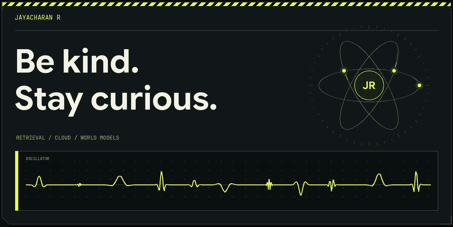
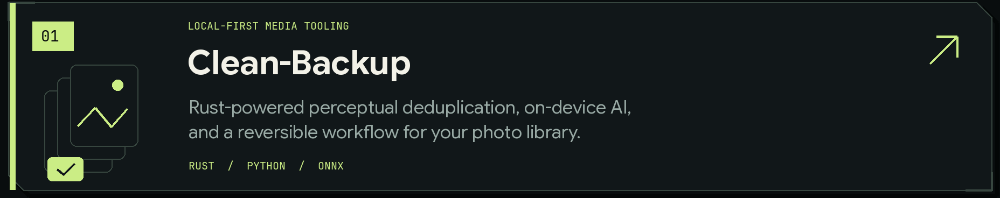
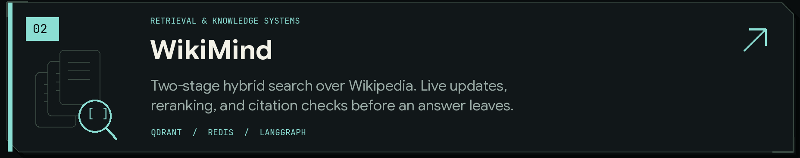
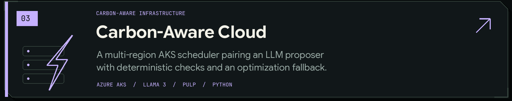
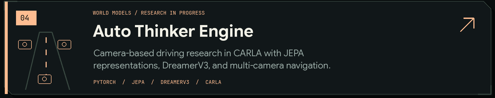
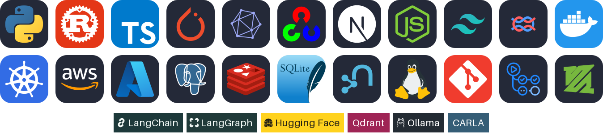

<picture>
  <source media="(prefers-reduced-motion: reduce) and (max-width: 600px)" srcset="assets/atomic-header-mobile-still.png">
  <source media="(prefers-reduced-motion: reduce)" srcset="assets/atomic-header-desktop-still.png">
  <source media="(max-width: 600px)" srcset="assets/atomic-header-mobile.gif">
  
</picture>

 

I’m **Jayacharan**. I build across AI, retrieval, and cloud infrastructure, with a soft spot for systems that can explain a decision, recover from a mistake, and hold up under scrutiny.

  
  
  

### Selected builds

<a href="https://github.com/JayacharanR/Clean-Backup">
  <picture>
    <source media="(prefers-color-scheme: light) and (max-width: 600px)" srcset="assets/atomic-clean-backup-mobile-light.png">
    <source media="(max-width: 600px)" srcset="assets/atomic-clean-backup-mobile.png">
    <source media="(prefers-color-scheme: light)" srcset="assets/atomic-clean-backup-light.png">
    
  </picture>
</a>

<a href="https://github.com/JayacharanR/WikiMind-End-to-End-Hybrid-RAG-Pipeline">
  <picture>
    <source media="(prefers-color-scheme: light) and (max-width: 600px)" srcset="assets/atomic-wikimind-mobile-light.png">
    <source media="(max-width: 600px)" srcset="assets/atomic-wikimind-mobile.png">
    <source media="(prefers-color-scheme: light)" srcset="assets/atomic-wikimind-light.png">
    
  </picture>
</a>

<a href="https://github.com/JayacharanR/Carbon-Aware-Cloud-Optimization">
  <picture>
    <source media="(prefers-color-scheme: light) and (max-width: 600px)" srcset="assets/atomic-carbon-aware-mobile-light.png">
    <source media="(max-width: 600px)" srcset="assets/atomic-carbon-aware-mobile.png">
    <source media="(prefers-color-scheme: light)" srcset="assets/atomic-carbon-aware-light.png">
    
  </picture>
</a>

<a href="https://github.com/JayacharanR/Auto_Thinker_Engine">
  <picture>
    <source media="(prefers-color-scheme: light) and (max-width: 600px)" srcset="assets/atomic-auto-thinker-mobile-light.png">
    <source media="(max-width: 600px)" srcset="assets/atomic-auto-thinker-mobile.png">
    <source media="(prefers-color-scheme: light)" srcset="assets/atomic-auto-thinker-light.png">
    
  </picture>
</a>

<strong>A closer look at the engineering ↴</strong>

 

| Project | The interesting part |
| :--- | :--- |
| [Clean-Backup](https://github.com/JayacharanR/Clean-Backup#architecture) | Rust/PyO3 hashing meets a Python pipeline. Local ONNX models handle classification; journaled file operations support session rollback. |
| [WikiMind](https://github.com/JayacharanR/WikiMind-End-to-End-Hybrid-RAG-Pipeline#architecture) | Discover articles, retrieve dense + sparse chunks, fuse and rerank, then check grounding and citations. Unverifiable answers become abstentions. |
| [Carbon-Aware Cloud](https://github.com/JayacharanR/Carbon-Aware-Cloud-Optimization#executive-summary) | Compare proposed region/start choices against an exact feasible-candidate reference. Check inputs and constraints, then fall back or hold when needed. |
| [Auto Thinker Engine](https://github.com/JayacharanR/Auto_Thinker_Engine#milestone-status-at-pause) | Compare visual representations and world-model approaches under explicit driving gates. Research is paused; final driving qualification remains open. |

### Experience

- **GenAI Intern · Tata Consultancy Services** (Jun–Jul 2026) — Worked on RAG search, prompt-injection guardrails, and Langfuse tracing.
- **SAP Analytics Cloud Intern · Blueprint Technologies** (May–Jul 2025) — Built SAP Analytics Cloud dashboards and predictive models.

### What connects the work

**Useful intelligence needs good systems around it.** That means fresh evidence for retrieval, explicit constraints for scheduling, reversible operations for personal data, and honest evaluation for learned policies.

<h3 align="center">✦ Tech stack ✦</h3>

  <picture>
    <source media="(max-width: 600px)" srcset="assets/tech-stack-mobile.png">
    
  </picture>

<h3 align="center">Certifications</h3>

  
  
  

---

Be kind. Stay curious. Build something worth understanding.
